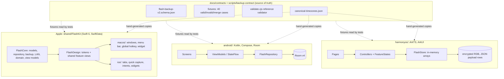

# Flash — architecture overview, technical debt and risk inventory

Date: 2026-11-11. Reviewed: `main` at `65c9212`, plus every remote branch, the two open PRs (#3, #5), CI run history, and all existing audit documents. Read-only review; no product code was changed.

**What was executed for this review:** the backup-contract and HarmonyOS host suites on `main` (265/265 pass, `generate-cases.cjs --check` clean), `tools/i18n/generate.py --check` on `feat/paper-writing` (791 keys, clean), and `git merge-tree` simulations between the open branches. Everything else is static reading. No Xcode, Gradle, DevEco, emulator or device run was possible in this environment, so nothing here is a device result.

**Existing audits this builds on** (finding IDs `F-nn` / `B-1` are reused, not renumbered):

| Document | Where it lives | Scope |
| --- | --- | --- |
| `docs/three-platform-refactoring-and-gap-remediation.md` (2026-09-04) | `main` | Architecture gaps `DATA-`, `ARCH-`, `PERF-`, `CONTRACT-`, `REL-` |
| `.superpowers/audit-2026-09-19/timezone-alignment-report.md` | `main` | Time-zone whitelist alignment |
| `docs/contracts/acceptance.md`, `docs/quality/device-matrix.md` | `main` | Contract and device acceptance state |
| `docs/review/00-baseline.md`, `01-codebase-baseline-review.md` (2026-10-25) | PR #3 only | Independent review: 27 findings, 5 High |
| `docs/hardening/*` (2026-10-24 → 11-01) | `feat/paper-writing`, `codex/ios-integrated-candidate` | Hardening implementation, evidence, LAN v2 decision |

---

## 0. The finding that reframes everything else

**`main` is not the current state of the project.** Three unmerged lines of work diverge from it, and the audits, the security fixes and all localization live on those lines, not on `main`.

| Branch | Ahead of `main` | Content | Status |
| --- | ---: | --- | --- |
| `feat/paper-writing` | 53 commits, 567 files, +131,917 / −7,799 | Hardening (LAN disabled, schema 2 on all four platforms, Room 4→5, time-zone fix, privacy), iOS share extension + Spotlight, Paper-Writing redesign, 8-language i18n | No PR. Merges into `main` cleanly |
| `fix/pr3-review-followups` | 9 commits, 120 files | A second, independent set of fixes for the PR #3 findings (LAN disable, schema 2, F-05, F-07, F-08, F-09, F-23) | No PR. **39 conflicted files** against `feat/paper-writing` |
| `claude/jolly-gates-5s78bx` (PR #5) | 7 commits, 127 files | Alignment grid, onboarding, accessibility options, icon pipeline, README rewrite | Open. **53 conflicted files** against `feat/paper-writing` |
| `codex/ios-integrated-candidate` | 48 commits | Ancestor of `feat/paper-writing` plus 2 commits (LAN v2 probes) | Stale |
| PR #3 `wip/review-handoff-2026-10-25` | 1 commit | The independent review itself | Open, "not reviewed for merge" |

Consequences, each verified:

- `main` still ships the legacy LAN transport that the owner approved disabling on 2026-10-24 (F-01 is present at `android/.../LocalBackupTransfer.kt:199-207`: a valid `CHALLENGE` line is answered with proof, header and the full payload in one pipeline).
- `main` still has Apple exporting section schema 2 while Android and HarmonyOS accept only schema 1 (`Backup.kt:219` compares against `SECTION_SCHEMA_V1`), so Mac/iPhone → Android/HarmonyOS import fails. The `main` README still says the formats are mutually readable.
- The same fixes (LAN disable, schema 2, time zones) were implemented twice, on `feat/paper-writing` and on `fix/pr3-review-followups`. The Room 4→5 migration SQL is identical on both, which is fortunate; the surrounding code conflicts in 39 files.
- Some fixes exist on only one line. `fix/pr3-review-followups` has the HarmonyOS obfuscation fix (F-05), the fragmented-receive fix (F-23) and the keep-rejected-rows merge fix (F-08); `feat/paper-writing` has none of those three as dedicated commits and its `obfuscation-rules.txt` is unchanged from `main`.
- PR #5 is based on `main`, so it still carries Room v4 and the 420-entry time-zone list.

> **Correction (2026-11-11, later the same day):** the anchored Swift ID and date patterns (F-09, commit `2187100`) are also only on `fix/pr3-review-followups`; `feat/paper-writing` still uses `^…$`. Wherever this report lists the fixes unique to that branch as F-05, F-08 and F-23, read F-05, F-08, F-09 and F-23. See `docs/standards/ADOPTION-ROADMAP.md` P0-02.

Until these lines are reconciled, every other item below is being fixed against a moving target.

---

## 1. Architectural overview

### 1.1 Product shape

Local-first journal / idea / mood / task app. No account, no backend. Data leaves a device only by user action: JSON export, system share sheet, or (on `main`) LAN transfer. Four native clients with deliberately no shared runtime across ecosystems; consistency is enforced by a written contract and shared fixtures instead.

### 1.2 Size on `main` (source lines)

| Area | Production | Tests | Notes |
| --- | ---: | ---: | --- |
| Android | 10,954 | 1,974 | Single Gradle module |
| FlashKit (shared Apple) | 10,370 | 3,184 | FlashCore 5,481 + FlashDesign 4,889 |
| macOS shell | 3,076 | 150 | |
| iOS shell | 2,382 | 221 | |
| HarmonyOS | 8,751 | 3,926 | Tests are Node host tests over transpiled `.ets` |

### 1.3 Per-platform architecture

| | Android | macOS / iOS | HarmonyOS |
| --- | --- | --- | --- |
| UI | Compose, single Activity, Navigation | SwiftUI; shared feature views in FlashDesign, thin per-OS shells | ArkUI, state management V1 (`@Observed`/`@ObjectLink`) |
| State | ViewModel + StateFlow | `@Query` for reads; `AppState` for navigation only | Per-feature controllers and `FeatureStates`; `FeatureProjection` republishes only changed partitions |
| Persistence | Room v4, exported schemas 3 and 4, migration tests | SwiftData versioned schema V1→V2; in-memory fallback on open failure | Encrypted RDB; rows are `id / sort_key / JSON payload`; whole dataset held in memory |
| Reads | `observeAll()` full-table flows, filter in memory | `@Query` direct; aggregates in pure domain functions | In-memory arrays, memoised by data version |
| Writes | Repository, Room transactions | Repository with rollback on save failure | Store serialises writes; transaction then publish |
| DI | Service locator: 12 `as FlashApplication` casts in screens | Single assembly point `RepositoryEnvironment.makeDefault()` | Controllers take injectable repositories |
| Reminders | WorkManager | UNUserNotificationCenter | reminderAgent / notification slots |
| Platform extras | Glass + Material dual style | Menu-bar companion, Carbon global hotkey, WidgetKit; iOS App Intents, Control Center, lock-screen widgets | Form card, fold/breakpoint layout, capability probes |
| Third-party runtime deps | Haze (blur) only, beyond AndroidX | None | None |

### 1.4 Cross-cutting design

- **Backup contract.** `flash-backup-v2` is an envelope with per-section schema versions. Strict entry (reject whole file) and a separate recovery entry (skip bad records, report count). Limits: 50 MiB, 100,000 records per section, UTF-16 length caps. Unknown fields and sections are rejected rather than dropped. This is the best-engineered part of the codebase.
- **Sync is deliberately absent.** `flash-sync-v1` is reserved as a separate future layer; snapshot backup semantics will not be bent into sync. Sound decision.
- **LAN transfer.** mDNS discovery, six-digit PIN, challenge/proof, payload HMAC. Present on `main`, removed from production on both hardening lines.
- **What is good and should be kept:** the contract-plus-fixtures approach, strict/recovery split, refusal to silently drop data, pinned CI action SHAs, Room schema export with migration tests, HarmonyOS quarantine of unparseable rows, evidence-tier discipline in the docs ("build ≠ simulator ≠ device").

### 1.5 Structural weak points

1. **Four hand-written implementations of one protocol** (Kotlin, Swift, ArkTS, plus the JS reference). Fixtures catch divergence only where a fixture exists; F-02, F-03, F-09 and F-23 all slipped through because no fixture exercised them.
2. **Generated constants are copied, not generated in CI.** `CanonicalTimeZones.{kt,swift,ets}` are ~425-line copies of one JSON file.
3. **HarmonyOS storage is a document store inside SQL.** No queryable columns, full load at start, validation at read time. Simple, but it is why F-08, F-25 and PERF-04 exist.
4. **Android reads are unbounded.** `observeAll()` on all three DAOs; indexes were added in v4 but queries do not use windows or paging.
5. **Apple fallback-to-memory is a silent mode switch** with destructive launch side effects (F-07) on `main`.
6. **The shared Apple package is tested by nothing in CI** (see D-02).

---

## 2. Technical debt, prioritised

Priority reflects blast radius × likelihood × how much other work it blocks. "Where fixed" names the branch that already contains a fix, if any.

### P0 — blocks any release or further parallel work

| ID | Debt | Evidence | Where fixed | Action |
| --- | --- | --- | --- | --- |
| D-01 | **Branch divergence**: three unmerged lines, duplicated fixes, 39–53 conflicted files between them | §0 | — | Pick one integration line (recommend `feat/paper-writing`, it merges cleanly into `main` and is the superset). Port the three `pr3-review-followups`-only fixes (F-05, F-08, F-23) onto it, rebase PR #5 onto it, close the rest. Freeze new feature branches until done |
| D-02 | **CI does not test what it claims to** | macOS job runs scheme `Flash`, whose only testable is `FlashTests` (13 tests). FlashKit's 194 tests (backup contract, repository, migration, LAN) run in no job and no scheme. No iOS job. No Android release/R8 build. No hvigor build. The workflow file is byte-identical on every branch | none | Add `swift test` for `shared/FlashKit`, iOS `build-for-testing`, Android `assembleRelease` with an ephemeral key, `tools/i18n/generate.py --check`. Do this first: it makes D-01 verifiable |
| D-03 | **Legacy LAN still enabled on `main`** | F-01, B-1, F-06 confirmed in `main` source | both hardening lines | Lands with D-01. Do not re-enable without a reviewed PAKE or ephemeral-key + SAS design |
| D-04 | **Schema 2 interop broken on `main`** | F-03; Android/HarmonyOS reject Apple exports | both hardening lines | Lands with D-01. Wire `valid-schema2.json` into Android and HarmonyOS tests |
| D-05 | **HarmonyOS release obfuscation vs JSON persistence** | F-05: property obfuscation on, only two global names kept, storage is `JSON.stringify` of model objects | `fix/pr3-review-followups` only | Port the fix; build one release HAP and diff exported keys against the schema before any HarmonyOS distribution |
| D-06 | **No signing or distribution path on any platform** | Android needs a new off-repo key; macOS adhoc only; iOS has no `DEVELOPMENT_TEAM`; HarmonyOS `signingConfigs: []` | — | Owner decision. Also blocks widgets (App Group) on macOS and real-device iOS |

### P1 — correctness and data safety

| ID | Debt | Evidence | Where fixed | Action |
| --- | --- | --- | --- | --- |
| D-07 | Time-zone whitelist is a legacy ICU list; one task in `Asia/Kolkata` or `Europe/Kyiv` fails the whole export | F-02 | both lines (439 names, alias resolution) | Lands with D-01; replace copied constants with a generation check in CI |
| D-08 | Apple in-memory fallback cancels reminders, wipes idea read-state, and advises "export now" (which exports an empty store) | F-07; on `main` `didFallbackToMemory` is only used to show the alert | both lines | Lands with D-01 |
| D-09 | HarmonyOS merge/overwrite deletes quarantined originals; transaction mixes sync begin with awaited writes | F-08, F-25 | F-08 on `pr3-review-followups`; F-25 unverified | Port F-08; F-25 needs one device fault-injection run |
| D-10 | HarmonyOS LAN receiver misparses split delivery | F-23 | `pr3-review-followups` | Moot while LAN is disabled; carry the split-delivery tests into any replacement |
| D-11 | Reminder semantics differ per platform; HarmonyOS publish-then-cancel may exceed the per-app quota | F-11, F-24, F-26, F-27 | none | Needs device runs; define one written reminder contract |
| D-12 | Import memory: 100k-record parse peaks near 2 GB RSS on host | `docs/hardening/performance.md` | parse time improved 4.5×, RSS unchanged | Streaming or chunked parse before claiming the 50 MiB limit is safe on phones |
| D-13 | HarmonyOS native RDB path has never been tested; all Store tests use a fake | `acceptance.md`, ets-loader | none | Blocked on a device or a DevEco emulator runner |

### P2 — structure and maintainability

| ID | Debt | Evidence | Action |
| --- | --- | --- | --- |
| D-14 | Android unbounded reads; settings layer owns backup, transfer, diff and reminder rebuild | PERF-01, ARCH-03; `SettingsScreen.kt` 601 lines, `SettingsViewModel.kt` 376 | Windowed queries; extract backup use cases |
| D-15 | Android service-locator DI | ARCH-02; 12 casts | `AppContainer` via CompositionLocal |
| D-16 | HarmonyOS payload-only RDB schema | PERF-04 | Add query columns in a dedicated migration, after D-13 |
| D-17 | Large multi-purpose files | `LocalBackupTransfer.swift` 938, `FlashStore.ets` 844, `BackupService.swift` 726. `Index.ets` is 506 lines; `acceptance.md` still says 398 | Split on next touch, not as a project |
| D-18 | Swift concurrency escape hatches | 25 uses of `nonisolated(unsafe)` / `@unchecked Sendable` / `@preconcurrency`; 40 `try?` in production Swift | Audit the `try?` sites on persistence and reminder paths first (REL-01) |
| D-19 | macOS and iOS shells duplicate Home, Explore, Settings (~350 lines each) | file listing | Move into FlashDesign as the shells converge |
| D-20 | Version identifiers never bumped | Android and HarmonyOS `versionCode 1`; iOS build 1; macOS build 2; all `0.1.0` despite a Room migration | One version source; bump on every schema change |

### P3 — hygiene

| ID | Debt | Evidence |
| --- | --- | --- |
| D-21 | Documentation drift: README claims interop that `main` does not have; ROADMAP references a root `CHANGELOG` that is not in the repo; README says `scripts/` is Android signing only; `acceptance.md` says `main` has required checks but the API reports `main` as unprotected (verify rulesets) |
| D-22 | Evidence stored outside the repo (`/Users/.../outputs/`, workspace `docs/superpowers/`) or as 28 MiB of screenshots inside `docs/hardening` on the candidate. Repo pack is already 38 MiB |
| D-23 | `.superpowers/` is gitignored yet one file under it is tracked |
| D-24 | Stale branches: `phase3-mobile-release` (no merge base with `main`), `feat/ios-native`, `feat/ios-warm-crafted`, `codex/ios-integrated-candidate` |
| D-25 | Local toolchain is Xcode beta and a non-standard `xcode-27` runner label; no fallback if that image changes |
| D-26 | Burned keystore and literal passwords remain in history on every branch (F-04). Declared void in `android/README.md`; history rewrite is an owner decision |

### Recommended order

1. D-02 (CI) — small, independent, makes everything after it checkable.
2. D-01 (converge branches), which lands D-03, D-04, D-07, D-08 in one step; port D-05, D-09, D-10.
3. D-05 release-HAP check, then D-06 signing decisions.
4. Device acceptance (D-11, D-13 and the transfer matrix), then P2.

---

## 3. Localization progress

### 3.1 On `main`: effectively none

| Platform | State on `main` |
| --- | --- |
| Android | `strings.xml` holds one string (`app_name`). ~457 Chinese literals inline in 37 of 65 Kotlin files. No `stringResource` use |
| iOS | No string catalog. ~186 literals in the shell and widget. `developmentRegion = zh-Hans` |
| macOS | No string catalog. ~177 literals. `developmentRegion = en` although all UI text is Chinese |
| FlashKit | ~442 literals, including in `FlashCore/Domain` (review insights, filter labels, reminder body) |
| HarmonyOS | ~514 literals in 32 of 47 `.ets` files. Only `app_name` has an `en_US` resource; form-card strings are resources but Chinese only |

Additional `main` issues: `DateFormatting.swift` hard-codes `zh_CN` and `yyyy年M月`; `WeeklyMemory.swift` returns English `"Mostly Positive"` / `"Mostly Low"` / `"Mostly Steady"` inside otherwise Chinese UI; user-facing sentences are assembled by string concatenation in the domain layer (`ReviewInsights.swift:90-96`), which cannot be translated correctly as fragments.

### 3.2 On `feat/paper-writing`: substantial, unmerged, unreviewed

Commits `31b8331`, `88ae8f6`, `19fd773` (2026-11-07).

- **One catalog for three platforms.** `docs/i18n/parts/*.tsv` → `translations.json`: 791 keys × 7 target languages (en, fr, ko, de, ru, ar, ja) plus zh source. `generate.py --check` passes: complete, no empty values, placeholders consistent.
- **Generated outputs.** iOS `Localizable.xcstrings` for app, widget and share extension plus `AppShortcuts.xcstrings`; Android `values-{ar,de,fr,ja,ko,ru,zh}/strings_generated.xml` and `I18nKeys.kt`; HarmonyOS per-locale `string.json`.
- **Runtime entry points.** Swift `L()`, Kotlin `Strings.get`, ArkTS `tr()`. Default language is English with zh as its own table.
- **Tests.** `LocalizationCatalogTests`, `LocalizationSafetyTests`, `EntryAndLocaleTest`.

Estimated wrap coverage on that branch (regex over string literals; an upper bound on what is unwrapped, since SwiftUI auto-localises some initialisers):

| Platform | Chinese literals | Routed through the catalog | Not routed |
| --- | ---: | ---: | ---: |
| HarmonyOS | 536 | 520 | 16 (mostly `EmotionPage.ets`) |
| Android (excl. generated `I18nKeys.kt`) | ~478 | ~416 | ~62 (`Models.kt`, `ReviewWindow.kt`, a few screens) |
| FlashKit | 447 | ~300 | ~147 |
| iOS shell + extensions | 267 | ~148 | ~119 (incl. tests; `CaptureIntents`, `SettingsScreen`, `ExploreScreen`) |
| macOS shell | 177 | 19 | 158 |

### 3.3 Localization gaps and risks

| ID | Gap | Detail |
| --- | --- | --- |
| L-01 | Not on `main`, no PR | Sits on the branch that conflicts with PR #5 in 53 files |
| L-02 | **macOS is excluded by design** | No catalog in the macOS target; `L()` looks up `.main` and falls back to the Chinese key. Shared FlashDesign views are therefore localised on iOS and Chinese on macOS |
| L-03 | Translations are unreviewed | ROADMAP on the branch: "七种新增译文待母语者复核". Treat all seven as machine drafts |
| L-04 | **No plural support** | No `variations` in any `.xcstrings`, no `<plurals>` in Android resources, no HarmonyOS plural entries. Russian and Arabic counts ("{0} 条") will be grammatically wrong |
| L-05 | The key is the Chinese source text | Any edit to a Chinese string silently orphans seven translations; only `--check` catches it and CI does not run it |
| L-06 | HarmonyOS resource names are a 32-bit FNV-1a hash of the source | `generate.py` has no collision detection |
| L-07 | Arabic RTL is unverified | Only ~10 layout-direction references across the three mobile codebases; the branch ROADMAP lists Arabic layout as an open acceptance item |
| L-08 | Locale-fixed formatting remains | `zh_CN` / `yyyy年M月` in `DateFormatting.swift`; hand-built date strings in `SearchScreen.swift` |
| L-09 | Display font is Chinese-only | Bundled LXGW WenKai is switched off for other locales (`usesBundledDisplayFont`), so non-Chinese UI has a different typographic design that has had no screenshot review |
| L-10 | Stored values vs display values | The rule "stored values must not go through `L()`" is a comment, enforced only by `LocalizationSafetyTests`. Enum raw values such as `ReviewWindow.week = "本周"` on `main` are the pattern to watch |
| L-11 | Store metadata, notification text, Siri phrases | Siri phrases are generated; App Store / AppGallery / Play listing text and the website are not in the catalog |

---

## 4. Risk inventory across the four platforms

Severity: **H** high, **M** medium, **L** low. Status: **Open** on `main`; **Cand.** fixed on a candidate branch but not merged; **Unverified** means no device evidence exists either way.

### 4.1 Cross-platform

| ID | Risk | Sev | Status |
| --- | --- | --- | --- |
| X-01 | Any LAN peer can pull the full plaintext backup without the PIN during the 60 s send window; sender reports success (F-01) | H | Open on `main`; Cand. |
| X-02 | Passive capture yields the PIN offline in about a second, then forged payloads carry a valid MAC (B-1) | M | Open on `main`; Cand. (disabled, no replacement) |
| X-03 | Backup is plaintext on the wire and at rest once exported; share-sheet recipients receive plaintext | M | By design; documented |
| X-04 | Apple ↔ Android/HarmonyOS file import fails on schema 2 (F-03) | H | Open on `main`; Cand. |
| X-05 | One timed task in a modern IANA zone blocks every export on that device (F-02) | H | Open on `main`; Cand. |
| X-06 | Protocol drift between four codecs wherever no fixture exists | M | Structural |
| X-07 | Installed-app transfer matrix (16 cells) and all physical-device directions are unverified; only codec-level interop is proven | H | Unverified |
| X-08 | Branch divergence causes a fix to be lost or a regression reintroduced at merge time | H | Open |
| X-09 | CI green does not mean Apple shared code works (D-02) | H | Open |
| X-10 | Large imports exhaust memory on phones (~2 GB host RSS at 100k records) | M | Open |
| X-11 | Bus factor of one; work produced by several AI agents on parallel branches with evidence held on one laptop | M | Open |
| X-12 | Seven unreviewed translations ship user-visible errors; no plurals; RTL untested | M | Cand. only |

### 4.2 Android

| ID | Risk | Sev | Status |
| --- | --- | --- | --- |
| A-01 | No release signing key; burned keystore in history could be reused by mistake (F-04) | M | Open; mitigated by env-only signing guard |
| A-02 | Release build (R8, `isMinifyEnabled = true`) has never been built in CI; reflection-free code lowers but does not remove the risk | M | Open |
| A-03 | Old Alpha010 APK in the wild is `debuggable` with `allowBackup=true` | M | Outside repo; marked stop-distributing |
| A-04 | Room v5 on candidates: a v4 binary cannot open a v5 database, so no downgrade path | M | Cand.; documented |
| A-05 | Full-table flows and in-memory filtering degrade with data size (PERF-01) | M | Open |
| A-06 | Reminders fail silently at fire time; overwrite import resets idea read-state (F-27, F-20) | L | F-20 Cand.; F-27 Open |
| A-07 | Aliyun Maven mirror is tried first outside CI; no dependency verification metadata | L | Open |
| A-08 | TalkBack full pass, 2.0 font scale, physical tablet not done | M | Unverified |
| A-09 | `versionCode` stuck at 1 blocks store upgrades | L | Open |

### 4.3 macOS

| ID | Risk | Sev | Status |
| --- | --- | --- | --- |
| M-01 | No Developer ID or notarisation: not distributable; widget permanently shows the placeholder because App Group needs real signing | H | Open |
| M-02 | In-memory fallback side effects and misleading "export now" advice (F-07) | M | Open on `main`; Cand. |
| M-03 | No notification delegate or action categories (F-12) | L | Open |
| M-04 | Database is plaintext without FileVault | L | By design; documented |
| M-05 | x86_64 slice never run on Intel hardware | L | Unverified |
| M-06 | Builds require Xcode beta / Swift 6.2 toolchain; CI depends on a non-default runner image | M | Open |
| M-07 | Excluded from localization (L-02) | M | Open |
| M-08 | VoiceOver audited via accessibility tree only, not spoken | L | Unverified |

### 4.4 iOS

| ID | Risk | Sev | Status |
| --- | --- | --- | --- |
| I-01 | No CI job at all; regressions invisible | H | Open |
| I-02 | No development team: never installed on a physical iPhone; widgets, Control Center, notifications, lock-screen privacy all simulator-only | H | Unverified |
| I-03 | Global search crash (missing `FocusRouter`) and AX5 clipping in calendar, task dates, emotion submit, compact capture | M | Found in C2 evidence; fixes `420c51c`, `4049a75`, `aa18464` on candidate |
| I-04 | Same fallback hazard as M-02, plus idea read-state wipe | M | Open on `main`; Cand. |
| I-05 | Privacy manifest declares only UserDefaults (F-18); check against file-timestamp and other required-reason APIs before submission | M | Open |
| I-06 | Root view depends on a non-observable revision counter (F-16) | L | Open |
| I-07 | Interactive widgets need the store moved into the App Group container, a data migration not yet designed | L | Deferred |
| I-08 | iOS 18–25 fallback paths (non-Liquid-Glass) are untested | M | Unverified |

### 4.5 HarmonyOS

| ID | Risk | Sev | Status |
| --- | --- | --- | --- |
| H-01 | **No device has ever run this app.** ArkUI runtime, encrypted RDB, reminders, forms, screen reader: all unverified | H | Unverified |
| H-02 | Release obfuscation may rename persisted and exported JSON keys (F-05) | H | Fix on `pr3-review-followups` only; needs a release build to confirm |
| H-03 | Merge/overwrite can delete quarantined originals (F-08); transaction binding uncertain (F-25) | M | F-08 fix on `pr3-review-followups`; F-25 hypothesis |
| H-04 | Reminder rebuild may exceed the system reminder quota (F-24) | M | Hypothesis |
| H-05 | No signing config; no hvigor build in CI; AGC listing absent | H | Open |
| H-06 | Host tests use fakes for every kit API; a fake that is wrong about platform behaviour passes silently (the suite already had to correct BOM and `mtime` unit assumptions) | M | Structural |
| H-07 | Whole dataset in memory, JSON-payload rows, validation at load (PERF-04) | M | Open |
| H-08 | `compatibleSdkVersion` API 12 with `targetSdkVersion` 26: every `canIUse` guard is an untested branch on old devices | M | Unverified |
| H-09 | Restricted capabilities (Live View, tap-to-share, Xiaoyi intents) need store review; currently probes only | L | Deferred, correctly |
| H-10 | State management V1; Huawei is steering new work to V2 | L | Deferred |

### 4.6 Top ten, across everything

1. X-08 / D-01 — converge the branches.
2. X-09 / D-02 — make CI run FlashKit, iOS, release builds, i18n check.
3. X-01 — get LAN disablement onto `main`.
4. X-04, X-05 — get schema 2 and time-zone fixes onto `main`.
5. H-02 — one release HAP build to settle obfuscation.
6. H-01, I-02, X-07 — first real-device pass on each platform and the file-transfer matrix.
7. M-01, A-01, H-05 — signing decisions.
8. M-02 / I-04 — fallback safety onto `main`.
9. X-12 — native-speaker review, plurals, RTL screenshots, macOS decision.
10. X-10 — bounded-memory import.

---

## 5. Not verified by this review

- Any build or test on Apple platforms, Android or HarmonyOS native toolchains.
- Whether `main` is protected by a ruleset (the branches API reports `protected: false`; classic protection is definitely absent).
- The content quality of the seven translations.
- The 28 MiB of screenshot evidence under `docs/hardening/evidence` was not opened.
- F-25, F-24, F-05 remain hypotheses exactly as the independent review left them.
