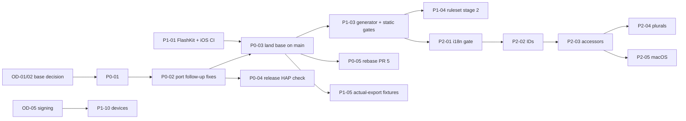

# Adoption roadmap

> **Status: Proposed — not ratified.** Sequencing depends on owner decisions listed in [ENGINEERING-STANDARDS.md §7](ENGINEERING-STANDARDS.md#7-owner-decisions).

> **中文摘要**：分四个阶段落地。P0：安全与阻断发布的正确性（先统一分支，使局域网停用、schema 2 互通、时区与降级模式修复进入主线；验证 HarmonyOS Release 混淆）。P1：契约与 CI 完整性（FlashKit 与 iOS 进入 CI、Android Release 构建、生成物检查、分支保护）。P2：本地化与资源体系收敛（语义键迁移、复数、macOS、图标与令牌）。P3：可维护性。工作量只给出有假设条件的档位（S/M/L），不编造天数。

## How to read this

**Effort bands.** The repository gives no velocity data, so effort is a band with its assumption, not a number of days.

| Band | Meaning | Assumption |
| --- | --- | --- |
| S | One focused session; a handful of files; no new toolchain | The agent has the toolchain the task needs |
| M | Several sessions on one platform or module; needs native builds | A machine with that platform's toolchain is available |
| L | Crosses platforms or needs devices, credentials or an owner decision midway | Owner is available for decisions; devices exist |
| ? | Cannot be bounded yet | States what must be learned first |

**Risk** is the risk of doing the item (regression, data loss), not the risk it removes.

**Suggested agent** follows two constraints: implementer and reviewer differ (FS-AGENT-12), and no more than two models of one provider are active at once (FS-AGENT-05). "Native-capable" means a session with Xcode, the Android SDK or DevEco available; the hosted session that wrote these standards has none of them. Agent names are suggestions for the owner to assign.

## P0 — Security and release-blocking correctness

| ID | Item | Platforms | Depends on | Risk | Effort | Deliverable | Acceptance criteria | Suggested agent |
| --- | --- | --- | --- | --- | --- | --- | --- | --- |
| P0-01 | Choose the integration base and freeze new feature branches | All | OD-01, OD-02 | Low | S (decision) | A written decision naming the base branch and the fate of each open branch | Decision recorded in ROADMAP; every open branch has an assigned writer or is closed | Owner |
| P0-02 | Port the fixes that exist only on `fix/pr3-review-followups` onto the base: property obfuscation off (F-05, `8123352`), keep rejected rows during merge (F-08, `ec53563`), anchored Swift ID and date patterns (F-09, `2187100`), fragmented LAN parse test carried as a fixture (F-23, `7bf6f51`). Compare the remaining commits (`fb2b484`, `2e77b5b`) against the base's own fixes for the same findings and keep one implementation | HarmonyOS, Apple | P0-01 | Medium: touches the HarmonyOS store | M | One PR on the base, one commit per finding | Host and FlashKit tests pass including the tests those commits add; `obfuscation-rules.txt` has no `-enable-property-obfuscation`; no behaviour beyond the listed findings | Implement: Codex (native-capable). Review: Claude |
| P0-03 | Land the base on `main` so that LAN disablement, schema 2, time zones and fallback safety are on the default branch | All | P0-01, P0-02, P1-01 preferred first | High: 567 files, includes a Room 4→5 migration and a visual redesign | L | Merged PR(s). The owner may prefer to split hardening from redesign and i18n; the history allows it only with care because they interleave | RB-01, RB-05, RB-06, RB-08 pass at host tier on `main`; all CI checks green; migration test from Room 3 and 4 to 5 passes on the emulator job | Integrate: owner with Codex. Independent review: Claude |
| P0-04 | Verify a HarmonyOS release build writes contract-conformant keys | HarmonyOS | P0-02; DevEco; a device or emulator | Low | S once a release HAP can be built; otherwise ? (blocked on OD-05, OD-13) | Evidence record: release HAP hash, exported JSON validated by `validate.cjs`, obfuscation name cache inspected | RB-07 recorded as pass or fail with evidence | Owner or native-capable agent; review by a second party |
| P0-05 | Rebase PR #5 onto the base and resolve its 53 conflicted files | All | P0-01 | Medium: UI on four platforms | M | Updated PR #5 or a replacement | All CI green; icon generator `--check` passes; onboarding and accessibility options present on the base without reverting hardening changes | Implement: Claude (authored PR #5). Review: Codex |
| P0-06 | Secret hygiene: extend `.gitignore`; add a deny-list check for the voided keystore fingerprint; decide OD-11 | Android, repo | OD-11 | Low | S | `.gitignore` entries; a script that fails when a release artefact is signed by the deny-listed certificate | Script exits non-zero on a test artefact signed with that key; documented in `android/README.md` | Any; review by owner |
| P0-07 | Record the security and permission baseline (FS-SEC-12) as snapshot files and the threat-model table as the reviewed version | All | P0-03 | Low | S | Snapshot of manifests and entitlements under `docs/contracts/` or `docs/standards/`; a check script | Check fails when a permission is added without updating the snapshot | Claude; review Codex |

## P1 — Cross-platform contract and CI integrity

| ID | Item | Platforms | Depends on | Risk | Effort | Deliverable | Acceptance criteria | Suggested agent |
| --- | --- | --- | --- | --- | --- | --- | --- | --- |
| P1-01 | Add `flashkit` and `ios-app` CI jobs | Apple | Hosted macOS runner minutes; owner approval for workflow change | Low to the product; may surface failing tests | S to write; ? to make green, because these suites have never run remotely | Workflow change | Jobs run on PRs touching `shared/`, `ios/`, `macos/`; test counts appear in the job log; failures are fixed or tracked, not skipped | Claude; review Codex |
| P1-02 | Add `android-release` (throwaway key, artefact inspection) and `android-lint` | Android | — | Low | S–M (R8 may reveal keep-rule issues) | Workflow jobs and an inspection script | Release APK builds; inspection asserts not debuggable, `allowBackup=false`, expected permission set | Codex; review Claude |
| P1-03 | Add `generated-check` and `static-gates` | All | P0-03 (scripts live on the base) | Low | S | Workflow jobs calling existing `--check` scripts and `check-lan-quarantine.py`; minimum-version and bundle-ID assertions; Markdown link check | Each generator check fails on a deliberately stale file in a test PR | Claude; review Kimi |
| P1-04 | Protect `main` with a ruleset and stage-1 required checks; then stage 2 | Repo | OD-12; P1-01..03 for stage 2 | Low | S | Ruleset export committed as documentation | Direct push to `main` is rejected; required checks match [BUILD-TEST-CI-STANDARD.md §6](BUILD-TEST-CI-STANDARD.md#6-required-checks-and-branch-rules) | Owner |
| P1-05 | Promote actual-export fixtures into `docs/contracts/fixtures/` and run them on all four codecs (FS-DATA-19) | All | P0-03 | Low | M | Four export fixtures from a fixed synthetic data set; tests on each platform | Each platform's strict importer accepts the other three exports and re-exports field-identical data, in CI at codec tier | Codex (has the probes); review Claude |
| P1-06 | Wire `valid-schema2.json` and the time-zone fixtures into Android and HarmonyOS tests if not already on the base | Android, HarmonyOS | P0-03 | Low | S | Test changes | `cases.json` coverage report lists every case for every codec | Kimi; review Codex |
| P1-07 | HarmonyOS native build gate: self-hosted runner or recorded manual run | HarmonyOS | OD-13 | Low | ? (runner feasibility and licensing unverified) | Either a CI job or an evidence-record template plus the first record | A HarmonyOS PR cannot merge without a build result tied to its commit | Owner; native-capable agent |
| P1-08 | Version discipline: one version file, CI assertion, build-number bump with the Room 4→5 migration | All | P0-03 | Low | S | Version source file; check script | CI fails when the four marketing versions differ | Any |
| P1-09 | Write the reminder contract (when due, cancel, rebuild order, quota behaviour) with shared vectors | All | — | Low to write; fixes that follow are Medium | M for the document and vectors; device confirmation L | `docs/contracts/reminders.md` and vectors | F-11, F-24, F-26, F-27 each mapped to a rule and a test or a "device needed" note | Claude (document); Codex (platform tests) |
| P1-10 | First real-device pass per platform and the installed-app transfer matrix | All | OD-05; devices | Low | L | Evidence records | Every cell of both matrices has a result or "not verified" with reason | Owner; agents prepare scripts and checklists only |

## P2 — Localization and resource-system convergence

| ID | Item | Platforms | Depends on | Risk | Effort | Deliverable | Acceptance criteria | Suggested agent |
| --- | --- | --- | --- | --- | --- | --- | --- | --- |
| P2-01 | Localization step 0: CI gate, collision and duplicate checks, mark all seven languages `machine` | Android, iOS, HarmonyOS | P0-03; P1-03 | Low | S | Generator changes; status column | `generate.py --check` runs in CI and fails on a hash collision test case | Claude; review Kimi |
| P2-02 | Step 1: assign semantic IDs and freeze `key-map.json` | Catalog only | P2-01 | Low: outputs unchanged | M (791 names to choose; mostly mechanical with review) | `id` column; key map | Generated outputs byte-identical before and after; every row has a unique ID matching the pattern | Kimi (Chinese source fluency); review Claude |
| P2-03 | Step 2: typed accessors and dual lookup; migrate call sites per module | Android, iOS, HarmonyOS, FlashKit | P2-02 | Medium: touches every UI file | L, done module by module | Generated accessors; codemod PRs | Unrouted-literal scan reaches zero outside the allowlist; UI unchanged in screenshots | One agent per platform at a time (FS-AGENT-02): Codex Apple, Kimi Android, Claude HarmonyOS; cross-review |
| P2-04 | Step 3: named placeholders, plurals, merged sentence fragments; move user-facing text out of domain and data layers (FS-ARCH-05) | All | P2-03 | Medium | ? until counted strings are inventoried | Catalog plural entries; generator plural output; refactored domain functions | Plural render test passes for counts 0, 1, 2, 3, 5, 11, 21, 101 in ru and ar; no CJK literal in domain or data code | Codex; review Claude |
| P2-05 | Step 4: macOS catalogs and macOS-only strings | macOS | OD-06; P2-03 | Low | M | Generator output for macOS targets; routed shell strings | macOS app shows English under an English system locale | Codex; review Claude |
| P2-06 | Locale-aware formatting pass (FS-L10N-16..18) | All | P2-03 | Low | M | Formatter usage replacing fixed patterns | No hard-coded display locale; export bytes identical under four device locales | Kimi; review Codex |
| P2-07 | RTL and long-text screenshot review; native-speaker review per language | Android, iOS, HarmonyOS | OD-07; P2-04; devices or simulators | Low | L (depends on reviewers) | Reviewed status per language; screenshot sets | Each shipping language has a named reviewer and date in the catalog | Owner and reviewers; agents produce screenshots |
| P2-08 | Icons: generator `--check` in CI; assets per FS-NAME-25..29 | All | P0-05 | Low | S | CI job | Check passes; AppScope and entry icon hashes equal | Claude |
| P2-09 | Design tokens: extend `paper-tokens.json` to Apple; semantic names; token conformance tests on all platforms | All | P0-03 | Low | M | Token file; tests | A changed token value fails the conformance test on every platform until regenerated | Kimi; review Claude |

## P3 — Maintainability and development efficiency

| ID | Item | Platforms | Depends on | Risk | Effort | Deliverable | Acceptance criteria | Suggested agent |
| --- | --- | --- | --- | --- | --- | --- | --- | --- |
| P3-01 | Android `AppContainer` injection replacing application casts (ARCH-02) | Android | P0-03 | Low | S–M | Refactor PR | No `as FlashApplication` in `ui/`; screens testable with fakes | Kimi |
| P3-02 | Android windowed queries and extraction of backup use cases from the settings layer (PERF-01, ARCH-03) | Android | Baseline measurements first | Medium | M | Query APIs; use-case classes | Timeline and calendar do not load full tables; measured before and after on the 10k data set | Codex |
| P3-03 | HarmonyOS queryable columns beside the payload (PERF-04) | HarmonyOS | P1-07; P1-10 (native RDB tested) | High: storage migration | L | Migration with tests on a real RDB | Migration test from the previous schema on a device or emulator; no data loss on a seeded store | Codex; review Claude |
| P3-04 | Converge duplicated macOS and iOS shell screens into FlashDesign | Apple | P2-03 | Medium | M | Shared views | Shell-specific code limited to navigation and platform adapters | Codex |
| P3-05 | Adopt formatters and linters, one platform per PR | All | FS-PLAT-10 approvals | Low | S per platform plus a one-off reformat | Config files; CI job | Lint job required; reformat commit is isolated | Any |
| P3-06 | Bounded-memory import (streaming or chunked parse) | All | Measurements on device | Medium | ? until a mobile memory budget is set | Parser change with the same fixtures | Peak memory at the 50 MiB limit is measured on a phone and within the chosen budget | Codex |
| P3-07 | Repository hygiene: move large evidence out of Git with manifests; delete stale branches; root `CHANGELOG.md`; fix README drift; `TOOLCHAIN.md` | Repo | P0-03 | Low | S | Docs and cleanup PRs | No binary evidence over an agreed size in new commits; README statements match `main` | Claude |
| P3-08 | Activate agent instruction files | Repo | OD-14 | Low | S | Root `AGENTS.md`, `CLAUDE.md` and the Kimi equivalent | Files are thin adapters pointing at `docs/standards/`; no rule is restated differently | Owner |
| P3-09 | Swift concurrency and error-handling audit (`try?`, unsafe annotations) on persistence and reminder paths | Apple | P1-01 | Low | M | PRs with comments or fixes | Each remaining suppression has a justification comment | Claude; review Codex |

## Critical path

P1-01 is placed before P0-03 on purpose: it is small, independent of the branch decision, and gives the large merge a remote safety net on Apple platforms.

## What this roadmap does not decide

Which line is the base; whether hardening and redesign land together; the LAN replacement; signing; languages to ship; whether macOS is localized. Each is an `OD-nn`. The roadmap states what becomes possible once each is answered.
