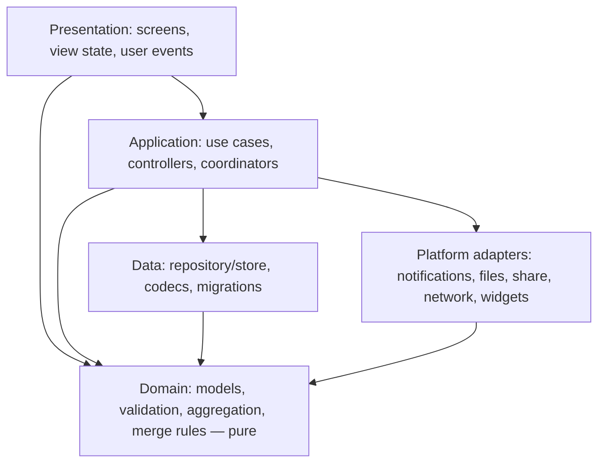

# Cross-platform architecture standard

> **Status: Proposed — not ratified.** See [README.md](README.md) for rule levels and labels.

> **中文摘要**：四端继续保持原生实现，不引入 KMP 或其他共享运行时。跨端一致性靠“契约 + 共用样例 + 生成常量”保证，而不是共享代码。本文规定各端职责、分层与依赖方向、FlashKit（FlashCore / FlashDesign）的归属与兼容约定、三种本地数据库的迁移规则，以及何时允许平台特有实现、何时必须遵守共享契约。

## 1. Current state

| Observation | Evidence |
| --- | --- |
| Four native codebases. Android: single Gradle module, Compose → ViewModel/StateFlow → `FlashRepository` → Room. Apple: `shared/FlashKit` (`FlashCore`, `FlashDesign`) plus thin `macos/` and `ios/` shells; reads via SwiftData `@Query`, writes via `FlashRepository`. HarmonyOS: pages → controllers and `FeatureStates` → `FlashStore` (in-memory arrays) → encrypted RDB with JSON payload rows. | Verified |
| Shared across ecosystems: `docs/contracts/` (schema, 40 fixtures), the Node reference validator, and `canonical-timezones.json`, which is copied by hand into `CanonicalTimeZones.{kt,swift,ets}`. | Verified |
| Android `domain/` and `data/` import no Compose. | Verified (`git grep`, 0 hits) |
| `FlashCore` imports SwiftUI in two files: `RepositoryEnvironment.swift` (an `EnvironmentKey` for the repository) and `FlashRepository.swift`. No AppKit or UIKit in `FlashCore`. | Verified |
| `FlashCore` contains user-facing Chinese text in `Domain/` (`ReviewInsights`, `LogFilter`, `IdeaReminder`, `GlobalSearch`) and builds sentences by concatenation. | Verified |
| Android screens obtain dependencies by casting the application context (12 sites). | Verified |
| macOS and iOS shells each carry their own Home, Explore and Settings screens of about 350 lines. | Verified |
| The September plan (§4) already defines the target layer model and dependency rules. HarmonyOS implemented it (ARCH-01 done); Android and Apple partly. | Verified (document), Inherited (status) |
| Four hand-written codecs diverged wherever no fixture existed: F-02, F-03, F-09, F-23. | Inherited (independent review) |

## 2. Platform responsibilities

| Concern | Owner | Notes |
| --- | --- | --- |
| Backup wire format, validation semantics, merge rules | `docs/contracts/` | Platforms implement; none may extend unilaterally |
| Domain rules (statistics, review windows, filters, reminders policy) | Each platform, to a shared written definition with shared test vectors | See FS-ARCH-07 |
| Persistence, migrations | Each platform | Room, SwiftData, RDB |
| UI, navigation, interaction, platform integrations | Each platform | Menu bar, widgets, App Intents, form cards, Material/Glass |
| Apple shared code | `shared/FlashKit` | One implementation for iOS and macOS |
| Design tokens, icons, strings | Generated from one source per kind | See [RESOURCE-NAMING.md](RESOURCE-NAMING.md), [LOCALIZATION-STANDARD.md](LOCALIZATION-STANDARD.md) |

## 3. Layers and dependency direction

| ID | Level | Rule | Enforcement |
| --- | --- | --- | --- |
| FS-ARCH-01 | MUST | Dependencies point only in the directions shown. Domain depends on nothing but the language standard library and Foundation-level value types. | Planned (import check per platform) |
| FS-ARCH-02 | MUST | Presentation does not call database, file, socket or notification APIs directly. It goes through a use case, controller or repository. | Manual; HarmonyOS has host tests for this boundary |
| FS-ARCH-03 | MUST | The local database is the only source of truth for user content. View state holds drafts, filters, selection and navigation, not copies of records that outlive the screen. | Manual |
| FS-ARCH-04 | MUST | All writes to user content go through one repository or store per platform. Reads may use the framework's native observation (`@Query`, Room `Flow`) where that is the platform idiom. | Manual |
| FS-ARCH-05 | MUST | Domain and data layers produce no user-facing prose. They return typed values, enum cases or message identifiers with arguments; the presentation layer turns them into localized text. | Planned; current violations listed in §1 |
| FS-ARCH-06 | MUST | Errors from persistence, import, export and reminder scheduling are propagated as typed errors to a layer that shows them. `try?` or an empty `catch` on these paths needs a comment explaining why the failure is safe to ignore. (REL-01.) | Manual |
| FS-ARCH-07 | MUST | A domain rule whose result must match across platforms (emotion statistics, review windows, idea-reminder threshold, merge conflict resolution, date and time-zone handling) has a language-neutral definition and shared test vectors under `docs/contracts/` or a sibling directory, consumed by each platform's tests. | Enforced for backup and merge; Planned for the rest |
| FS-ARCH-08 | SHOULD | Dependencies are passed in explicitly (constructor, environment, CompositionLocal). New code does not reach for a global application object. | Manual |

**Rationale.** FS-ARCH-05 is what makes localization and testing tractable: today translated strings must be threaded into pure functions. FS-ARCH-07 generalises the one mechanism that has reliably prevented divergence.

### Platform notes

- **Android.** `ui/` is presentation; ViewModels are the application layer; `domain/` and `data/` as named. FS-ARCH-08 means replacing the `as FlashApplication` casts with an `AppContainer` provided through a `CompositionLocal` (ARCH-02). No multi-module split is required at the current size.
- **Apple.** `FlashCore` = domain + data + application; `FlashDesign` = tokens and shared presentation; `ios/`, `macos/` = shells and platform adapters. `@Query` in views is allowed under FS-ARCH-04. The SwiftUI import in `FlashCore` is tolerated only for dependency injection plumbing (`EnvironmentKey`); see FS-ARCH-11.
- **HarmonyOS.** `pages/` and `components/` are presentation; `state/` is application; `data/` is data; `models/` is domain. `PageActions` is the only route from pages to controllers.

## 4. FlashKit ownership and compatibility

| ID | Level | Rule | Enforcement |
| --- | --- | --- | --- |
| FS-ARCH-09 | MUST | Logic needed by both iOS and macOS lives in FlashKit, once. A second copy in a shell is a defect unless it is a platform adapter. | Manual |
| FS-ARCH-10 | MUST | `FlashCore` does not import AppKit, UIKit or WidgetKit. Platform differences inside FlashKit are confined to named files behind `#if os(...)` / `#if canImport(...)`, and are listed in `shared/FlashKit/README.md`. | Planned (import check); currently true |
| FS-ARCH-11 | SHOULD | `FlashCore` does not import SwiftUI except for environment plumbing. View models in `FlashCore/Presentation` use Observation, not SwiftUI types. | Planned |
| FS-ARCH-12 | MUST | FlashKit's public API is deliberate: every `public` symbol is used by a shell or a test. Public value types are explicitly `Sendable`. | Manual |
| FS-ARCH-13 | MUST | SwiftData entity names and the store location do not change without a migration and a migration test that opens a store written by the previous release. Entity names carry no module prefix. (Existing rule in the FlashKit README.) | Enforced-in-package: `SchemaMigrationTests` exists but FlashKit tests are not in CI |
| FS-ARCH-14 | MUST | A change to FlashKit is verified on both shells before merge: `swift test` in the package, plus build of the iOS and macOS apps. | Planned (CI) |
| FS-ARCH-15 | SHOULD | Shell screens that are functionally the same on iOS and macOS (Home, Explore, Settings) converge into `FlashDesign` over time, differing through `Support/PlatformModifiers.swift`. | Manual |

## 5. Persistence and migrations

| ID | Level | Rule | Enforcement |
| --- | --- | --- | --- |
| FS-ARCH-16 | MUST | Every schema change ships with: a forward migration, the exported schema or version identifier, and a test that migrates from every released schema version. | Android: Enforced (emulator job, schemas 3–4). Apple: test exists, not in CI. HarmonyOS: Planned |
| FS-ARCH-17 | MUST | No destructive migration and no "recreate on failure". If the store cannot be opened, user data on disk is left untouched and the app enters a clearly labelled degraded mode. | Manual |
| FS-ARCH-18 | MUST | In a degraded or in-memory mode the app performs no side effect derived from the (empty) data set: no reminder rebuild, no widget overwrite, no read-state pruning, and export is blocked or labelled. (F-07.) | Enforced-candidate (both hardening lines) |
| FS-ARCH-19 | MUST | Migrations are additive where possible (new nullable columns). A migration that an older binary cannot open is stated in the release notes as a no-downgrade boundary. | Manual |
| FS-ARCH-20 | MUST | Multi-record operations (import merge, overwrite, clear) run in one transaction; in-memory state is published only after commit. | Android/Apple: tests exist. HarmonyOS: host tests with a fake; device unverified (F-25) |
| FS-ARCH-21 | MUST | Local-only state (idea read-state, notification IDs, device IDs) is stored apart from portable content and never enters a backup. | Enforced (contract rejects unknown fields) |
| FS-ARCH-22 | SHOULD | HarmonyOS adds queryable columns beside the JSON payload in a dedicated migration, after a native-RDB test tier exists. (PERF-04.) | Planned |

**Platform notes.** Room: schema JSON exported to `android/app/schemas/`; version 4 on `main`, 5 on candidates (five nullable columns). SwiftData: `FlashSchemaV1` → `FlashSchemaV2`. HarmonyOS: `logs`, `emotions`, `tasks`, `idea_view_state` tables with `id / sort_key / payload`; because model objects are serialised with `JSON.stringify`, property obfuscation changes the stored format (see [SECURITY-AND-DATA-CONTRACT.md](SECURITY-AND-DATA-CONTRACT.md) FS-DATA-17).

## 6. Avoiding four divergent implementations

| ID | Level | Rule | Enforcement |
| --- | --- | --- | --- |
| FS-ARCH-23 | MUST | A cross-platform behaviour change lands in this order: contract or definition → fixtures and vectors → reference validator → each platform. A platform PR that changes shared behaviour without the first two is rejected. (ROADMAP principle; September plan §10.) | Manual |
| FS-ARCH-24 | MUST | Constants shared by more than one platform are generated from one file by a script with `--check`. Hand-edited copies are not allowed. Applies to time-zone lists, string resources, design tokens, icon derivatives, protocol limits. | Enforced-candidate for time zones (`generate-timezones.py --check`), strings (`generate.py --check`), icons (`generate_app_icons.py --check`); none run in CI |
| FS-ARCH-25 | MUST | Every defect found in one platform's implementation of shared behaviour produces a fixture or vector that would have caught it, and that fixture runs on all platforms. | Manual |
| FS-ARCH-26 | MUST | A platform that cannot yet implement a contract version rejects it explicitly. It does not accept and drop fields. | Enforced (schema 2 rejection on Android/HarmonyOS `main`) |
| FS-ARCH-27 | SHOULD | A feature reaches all four platforms within one release, or the release notes state which platforms lack it. Feature parity is tracked in one table, not in four READMEs. | Manual |

### When platform-specific implementations are acceptable

| Acceptable (MAY differ) | Must follow a shared contract (MUST match) |
| --- | --- |
| Navigation structure, layout, gestures, animation | Backup format, validation, merge and overwrite results |
| Input controls (slider vs emoji buttons for mood) | Meaning and range of every stored field |
| Integrations: widgets, menu bar, intents, form cards, hotkeys | Date, instant and time-zone semantics |
| Persistence technology and table layout | What is local-only versus portable |
| Notification mechanics | When a reminder is due and when it is cancelled (to be written: D-11) |
| Visual style within the token system | Limits: sizes, counts, text lengths |
| Wording that follows platform conventions | String meaning and placeholders (one catalog) |

## 7. Non-goals

| ID | Level | Rule |
| --- | --- | --- |
| FS-ARCH-28 | MUST NOT | Introduce Kotlin Multiplatform, a shared C++/Rust core, a web view layer or a cross-platform UI toolkit without an owner decision supported by measured evidence that the contract-and-fixture approach has failed. |

Enforcement: Manual (owner decision required).

**Rationale.** About 36,000 lines of working native code and four different persistence stacks exist. The divergences found so far were fixture gaps, not consequences of having four codebases, and ArkTS has no practical shared-runtime path with Kotlin or Swift. The September plan reached the same conclusion.

## 8. Testable criteria

- `git grep -E '^import (AppKit|UIKit|WidgetKit)' -- shared/FlashKit/Sources/FlashCore` returns nothing.
- `git grep -E '^import androidx\.compose' -- android/app/src/main/java/com/flash/app/{domain,data}` returns nothing.
- No CJK string literal in `FlashCore/Domain`, `android/.../domain`, or HarmonyOS `data/` and `models/` after FS-ARCH-05 is adopted.
- Each generated file is byte-identical to generator output (`--check` exits 0).
- Every released database version has a migration test.

## 9. Migration impact

FS-ARCH-05 touches about ten domain files per ecosystem and is best done together with the localization key migration. FS-ARCH-08 on Android is a mechanical change across 12 call sites. FS-ARCH-14, -24 need only CI jobs. Nothing here requires restructuring modules.

## 10. Verification

Import checks and generator checks in CI ([BUILD-TEST-CI-STANDARD.md](BUILD-TEST-CI-STANDARD.md)); review checklist for the Manual rules; migration tests per FS-ARCH-16.

## 11. Exceptions

FS-ARCH-17, -18, -26 and -28 have no reviewer-level exception; owner only. A platform adapter may bypass FS-ARCH-02 when the platform forces it (for example an App Intent that must write without UI), provided it calls the same repository.
