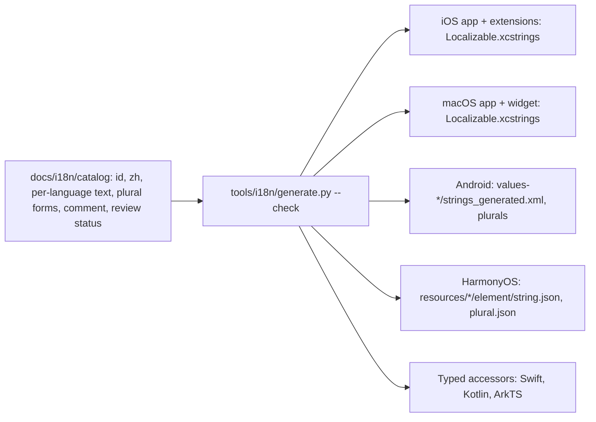

# Internationalization and localization standard

> **Status: Proposed — not ratified.** See [README.md](README.md) for rule levels and labels.

> **中文摘要**：`main` 上基本没有本地化；`feat/paper-writing` 分支有一套 791 条、八种语言（中文原文加七种译文）的统一目录，可生成 iOS、Android、HarmonyOS 资源，但尚未合并、译文为机器辅助且未经母语者复核、不支持复数、以中文原文作为键、macOS 被排除在外。本文规定长期架构：稳定的语义键、单一目录与确定性生成、复数与 ICU 风格格式、RTL、区域化数字与日期、回退规则、无障碍文案、占位符校验、译文审核状态，以及不丢失现有译文的五步迁移路径。机器译文在有具名审核人之前不得标为“已审核”。

## 1. Current state

### 1.1 `main` (Verified)

No localization. Android `strings.xml` has one entry; no Apple string catalog; HarmonyOS has an `en_US` resource for the app name only. Roughly 1,800 Chinese string literals are inline in source. `DateFormatting.swift` hard-codes `zh_CN` and `yyyy年M月`. `WeeklyMemory.swift` returns English labels inside a Chinese UI. Domain code concatenates sentence fragments (`ReviewInsights.swift`).

### 1.2 `feat/paper-writing` (Verified unless noted)

| Aspect | State |
| --- | --- |
| Source of truth | `docs/i18n/parts/*.tsv` (8 columns: zh source, en, fr, ko, de, ru, ar, ja) merged into `docs/i18n/translations.json`; key inventory in `docs/i18n/keys.json`; fixed terms in `docs/i18n/glossary.json` |
| Size | 791 keys × 7 target languages; `generate.py --check` passes (complete, non-empty, placeholders consistent) — run for this work |
| Generator | `tools/i18n/generate.py` writes iOS `Localizable.xcstrings` for `ios/Flash`, `ios/FlashWidget`, `ios/FlashShare` and `AppShortcuts.xcstrings`; Android `values{,-zh,-fr,-ko,-de,-ru,-ar,-ja}/strings_generated.xml` and `I18nKeys.kt`; HarmonyOS `resources/{base,zh,fr,ko,de,ru,ar,ja}/element/string.json` |
| Key collection | `tools/i18n/collect.py`: iOS keys come from compiled `.stringsdata` (needs an Xcode build); Android and HarmonyOS keys come from scanning `tr()` calls |
| Key | The Simplified Chinese source text, with `{0}` placeholders |
| Runtime | Swift `L(_:)` → `String(localized:bundle: .main)`; Kotlin `tr()` → `Strings.get` via a `Map<String, Int>` of source text to resource ID; ArkTS `tr()` → resource named `s_<FNV-1a 32-bit of source>` |
| Default language | English. Android `values/` is English and `values-zh/` Chinese; HarmonyOS `base/` is English; iOS `developmentRegion = en` with catalog `sourceLanguage = zh-Hans` |
| Plurals | None. `I18nKeys.plurals` is generated as `emptyMap()`; no `variations` in any catalog; no HarmonyOS plural resources. The runtime wrappers have plural hooks that are never fed |
| Digits | Wrappers substitute placeholders by plain string replacement so numbers stay ASCII (stated in code comments) |
| Review | `glossary.json`: "Machine-assisted; needs native-speaker review before release". ROADMAP: seven translations await native review |
| Tests | `LocalizationCatalogTests`, `LocalizationSafetyTests` (Swift), `EntryAndLocaleTest` (Kotlin) |
| CI | `generate.py --check` is not run by any workflow |
| Residual literals | Regex estimate: HarmonyOS 16 unrouted of 536; Android about 62 outside the generated map; FlashKit about 147; iOS shell about 119; macOS shell 158 of 177. Upper bounds: SwiftUI auto-localizes some initialisers |

### 1.3 Why macOS is excluded (Verified)

Four independent causes, all visible in the tree:

1. **Scope.** The Paper-Writing candidate was defined for the three mobile clients. `macos/README.md` on that branch states that macOS keeps the current Chinese interface and brand baseline.
2. **No generated output.** `generate.py` writes catalogs only into `ios/…` folders. The macOS project has no `.xcstrings` file and its `knownRegions` is still `en, Base, zh-Hans`.
3. **Bundle lookup.** `L()` resolves against `Bundle.main`. In the macOS app that bundle has no catalog, so every lookup returns the key, which is the Chinese text. The doc comment on `L()` says this is intended. Shared `FlashDesign` views are therefore translated on iOS and Chinese on macOS from the same source.
4. **Key collection.** iOS keys are harvested from an iOS build's `.stringsdata`. Strings that exist only in the macOS shell (menu commands, menu-bar companion, Quick Capture panel, settings sections) were never collected, so they have no catalog rows at all.

None of these is a technical barrier. Cause 4 is the real cost: the macOS-only strings must be collected and translated.

## 2. Target architecture

## 3. Single source and generation

| ID | Level | Rule | Enforcement |
| --- | --- | --- | --- |
| FS-L10N-01 | MUST | One catalog under `docs/i18n/` is the only place a user-visible string is defined. Platform resource files are generated and carry a "generated, do not edit" header. | Enforced-candidate (`generate.py`), not in CI |
| FS-L10N-02 | MUST | Generation is deterministic: same catalog, same bytes. Output is sorted by key; no timestamps. `generate.py --check` regenerates in memory and fails on any difference. | Planned (CI job) |
| FS-L10N-03 | MUST | The generator validates: every key present in every shipping language; no empty value; identical placeholder sets; no duplicate IDs; no resource-name collision on any platform; plural entries carry every CLDR category the language needs. | Partly present (first three); collision and plural checks Planned |
| FS-L10N-04 | MUST | Hand-authored platform strings that the OS requires outside the catalog mechanism (Android manifest labels, HarmonyOS `module.json5` labels, Apple `InfoPlist` strings, App Shortcut phrases) are still sourced from the catalog and emitted by the generator. | Partly present (`HAND_ANDROID`, `harmony-hand-strings.json`, `siri_phrases.py`) |
| FS-L10N-05 | MUST | A user-visible string is never added directly in a platform resource file or as an unrouted literal. | Planned (literal scanner in CI, with an allowlist) |

## 4. Keys

| ID | Level | Rule | Enforcement |
| --- | --- | --- | --- |
| FS-L10N-06 | MUST | Each string has a stable semantic ID: `area.screen.element[.variant]`, lowercase ASCII, segments in `snake_case`, for example `backup.import.diff_title`, `home.capture.placeholder`, `common.action.save`. The ID does not encode the wording. | Planned |
| FS-L10N-07 | MUST | The Chinese text is a value in the `zh` column, not the key. Editing Chinese wording changes no ID and orphans no translation; it marks the other languages `needs_update`. | Planned |
| FS-L10N-08 | MUST | Platform resource names derive mechanically from the ID: Android and HarmonyOS replace `.` with `_`; Apple uses the ID as the catalog key. Hash-derived names are retired. | Planned |
| FS-L10N-09 | MUST | An ID is never reused for a different meaning. Removing a string removes the ID. | Manual |
| FS-L10N-10 | SHOULD | Call sites use generated typed accessors (`L10n.Backup.Import.diffTitle`, `Strings.backupImportDiffTitle(count)`), so a missing or misspelled key is a compile error and unused keys can be detected. | Planned |
| FS-L10N-11 | MUST | Every entry has a translator comment when the text is short, ambiguous, or contains a placeholder (what `{count}` is, where the string appears). | Manual |

**Rationale.** With source-text keys, a typo fix in Chinese silently detaches seven translations, two strings with the same Chinese text but different meaning cannot be told apart, and HarmonyOS needs a 32-bit hash with no collision check. Stable IDs remove all three problems and are what Android and HarmonyOS resource systems expect.

## 5. Grammar, formatting and layout

| ID | Level | Rule | Enforcement |
| --- | --- | --- | --- |
| FS-L10N-12 | MUST | Any string containing a count uses plural forms by CLDR category (`zero, one, two, few, many, other`). The generator emits Apple `variations.plural`, Android `<plurals>`, and HarmonyOS plural resources. Russian and Arabic require categories beyond `one/other`. | Planned |
| FS-L10N-13 | MUST | Placeholders are named (`{count}`, `{date}`, `{title}`), not positional, in the catalog. The generator converts to `%1$d` / `%lld` / `%d` as each platform requires. Translators may reorder them. | Planned (currently `{0}`, `{1}`) |
| FS-L10N-14 | MUST | A sentence is one catalog entry. Code never builds a sentence by concatenating fragments or by appending translated pieces. | Manual; known violation: `ReviewInsights` |
| FS-L10N-15 | SHOULD | Where a string needs plural plus select (gender, category), the catalog stores an ICU MessageFormat pattern and the generator expands it to platform forms. ICU is not required at runtime. | Planned |
| FS-L10N-16 | MUST | Dates, times, relative dates, numbers, percentages and durations shown to the user are produced by the platform's locale-aware formatter with the user's locale and calendar. No fixed patterns such as `yyyy年M月` and no hard-coded locale identifiers in display code. | Planned (grep for `Locale(identifier:` and CJK date patterns outside the wire-format code) |
| FS-L10N-17 | MUST | Wire and storage formatting is locale-independent: `en_US_POSIX` / `Locale.ROOT`, Gregorian calendar, ASCII digits. Stored values never pass through a localization call. | Enforced-candidate (`LocalizationSafetyTests`); contract tests on `main` |
| FS-L10N-18 | MUST | The app honours the user's calendar and first weekday in calendar views. The portable representation stays ISO-8601 Gregorian. | Manual |
| FS-L10N-19 | MUST | Layout uses leading/trailing (start/end), never left/right, for anything that should mirror. Android keeps `supportsRtl="true"`. Directional icons mirror; brand marks, media controls, clocks and charts with a time axis do not. | Manual; RTL screenshot gate |
| FS-L10N-20 | MUST | User-generated text is displayed with its own natural direction, isolated from surrounding UI text. | Manual |
| FS-L10N-21 | MUST | Layouts tolerate text 40 % longer than English and the largest accessibility text size without truncating meaning. | Manual; screenshot gate |
| FS-L10N-22 | MUST | A bundled display font is applied only to scripts it covers; other locales use the system font, and that typography is reviewed in screenshots like any other design. | Present (`usesBundledDisplayFont`); review Manual |

## 6. Fallback, accessibility and dynamic content

| ID | Level | Rule | Enforcement |
| --- | --- | --- | --- |
| FS-L10N-23 | MUST | Fallback order is the same on every platform: exact locale → language → English. Chinese is selected only for Chinese locales. A missing key in a shipping language is a build failure, not a runtime fallback. | Planned (parity check); needs per-platform verification that the OS resolver behaves this way |
| FS-L10N-24 | MUST | The behaviour for Traditional Chinese locales is an explicit decision (OD-09), not an accident of resource-directory matching. | Undecided |
| FS-L10N-25 | MUST | Accessibility labels, hints, values and announcements are catalog entries, translated like visible text. An icon-only control has a label. Step and position announcements use plural-aware entries. | Manual |
| FS-L10N-26 | MUST | Notification titles and bodies, widget text, App Shortcut phrases, share-sheet labels, form-card text and error messages shown to the user are catalog entries. | Partly present |
| FS-L10N-27 | MUST | Error messages raised in data or domain code are typed errors mapped to catalog entries at the presentation boundary. Backup validation paths (JSON pointers, field names) stay untranslated inside the message as data. | Planned; today `Backup.kt` calls `tr()` inside the codec |
| FS-L10N-28 | MUST | Text written into exported files, logs or stored records is not localized, with one exception decided per field in the contract (for example a human-readable `notes`). | Manual |
| FS-L10N-29 | SHOULD | In-app language follows the system language. A per-app language switch uses the platform mechanism (Android per-app locales, iOS Settings) and is not re-implemented. | Manual |

## 7. Translation quality

| ID | Level | Rule | Enforcement |
| --- | --- | --- | --- |
| FS-L10N-30 | MUST | Each language carries a review status per entry or per batch: `machine`, `reviewed` (with reviewer name and date), `needs_update`. Status lives in the catalog. | Planned |
| FS-L10N-31 | MUST | Nothing is marked `reviewed` without a named native or fluent reviewer. All seven current translations are `machine`. | Manual |
| FS-L10N-32 | MUST | A language ships only when all of its entries are `reviewed`, the generator checks pass, and screenshots of the primary screens in that language have been looked at (RTL for Arabic). A language that does not meet this is excluded from the build's locale list rather than shipped as a draft. | Manual; build-time locale list Planned |
| FS-L10N-33 | MUST | `glossary.json` terms are applied consistently; the generator warns when a glossary source term appears without its fixed translation. | Planned |
| FS-L10N-34 | SHOULD | A pseudo-locale build (accented, lengthened, bracketed) is used to find unrouted strings and truncation before translation. | Planned |
| FS-L10N-35 | MUST | Checks run in CI: catalog validation (FS-L10N-03), stale-output check, unrouted-literal scan, unused-key report, per-platform resource parity. | Planned |

## 8. Migration path

The path keeps every existing translation and never requires a flag-day change to call sites.

| Step | Change | Translations affected | Call sites affected |
| --- | --- | --- | --- |
| 0. Gate | Run `generate.py --check` in CI. Add FNV collision detection and a duplicate-source check. Mark all seven languages `machine`. No new languages. | None | None |
| 1. Assign IDs | Add an `id` column to the TSV parts and a frozen `docs/i18n/key-map.json` (`id` ↔ current Chinese source). The generator still emits today's outputs keyed as today. | None; rows are re-keyed in place, one-to-one over the 791 entries | None |
| 2. Dual lookup | Generator additionally emits ID-named resources and typed accessors. Runtime wrappers accept either an ID or legacy source text (resolved through the key map). | None | Migrated module by module with the existing `*_wrap.py` codemods; both forms work throughout |
| 3. Grammar | Named placeholders; plural entries for every counted string; sentence fragments merged. | Entries that change shape go to `needs_update` for the affected languages only | The counted and concatenated call sites |
| 4. macOS | Generator emits catalogs for the macOS app and widget; macOS-only strings are collected and added; `knownRegions` updated. `L()` keeps resolving against the main bundle, which now has a catalog. | New rows for macOS-only strings, status `machine` | macOS shell literals routed |
| 5. Retire legacy | Remove source-text lookup, the key map's legacy direction and hash-named HarmonyOS resources. | None | None remaining |

Steps 0 and 1 are safe to do before the branch question (OD-01) is settled, as long as they are done on the line that holds the catalog. Step 4 depends on OD-06. Shipping any language depends on OD-07.

## 9. Platform considerations

- **Apple.** One generated `Localizable.xcstrings` per bundle (app, widget, share extension), because `Bundle.main` inside an extension is the extension. If catalogs are later moved into FlashKit as package resources, `Package.swift` needs `defaultLocalization` and `L()` must take `Bundle.module`; that is optional and not required by this standard. `InfoPlist.xcstrings` and `AppShortcuts.xcstrings` are generated too. SwiftUI `Text("literal")` auto-localizes; under typed accessors prefer `Text(L10n.…)` so the scanner has one form to check.
- **Android.** `values/` holds English; `values-zh/` Chinese. `<plurals>` for counted strings. `tools:ignore="MissingTranslation,ExtraTranslation"` in generated files is removed once parity is enforced by the generator, so lint can also see gaps. JVM unit tests run without resources, which is why `Strings.get` returns the source text when no context is installed; with typed accessors the test fallback returns the `zh` or `en` value from a generated table.
- **HarmonyOS.** `resources/base/element/string.json` is the fallback (English); qualifier directories per language. Plural strings go in `plural.json` and are read with `getPluralStringByNameSync`. Resource names must match `[a-zA-Z0-9_]+`, which the ID mapping satisfies. `AppScope` strings (app name) stay bilingual at minimum.
- **FlashKit.** `FlashCore` returns typed values; `FlashDesign` and the shells resolve text (see [CROSS-PLATFORM-ARCHITECTURE.md](CROSS-PLATFORM-ARCHITECTURE.md) FS-ARCH-05).

## 10. Testable criteria

- `generate.py --check` exits 0 and reports the key count; the count is equal across all platform outputs and languages.
- No two IDs map to the same Android, HarmonyOS or Apple resource name.
- Scanner finds no CJK or user-visible literal outside the catalog accessors, minus an explicit allowlist (tests, debug seeder, wire constants).
- For each plural entry and each shipping language, every required CLDR category is present; a test renders counts 0, 1, 2, 3, 5, 11, 21, 101.
- A test asserts that export output is byte-identical under `zh`, `en`, `ar` and `ru` device locales.
- Arabic screenshots of the primary screens exist for each mobile platform before Arabic ships.

## 11. Migration impact

Steps 0–1 touch only `docs/i18n/` and `tools/i18n/`. Step 2 touches every UI file once, mechanically. Step 3 changes the shape of an unknown number of entries; the counted strings must be inventoried first (the catalog uses `{0} 条`-style patterns). Step 4 adds an estimated 150–180 macOS-only rows (from the literal count, upper bound).

## 12. Verification

CI jobs per FS-L10N-35; the existing three test classes; screenshot review per language; reviewer sign-off recorded in the catalog.

## 13. Exceptions

Debug-only UI and developer diagnostics MAY stay unlocalized if they are excluded from release builds. A string MAY ship in fewer languages than the app only by owner decision, recorded with the release.
